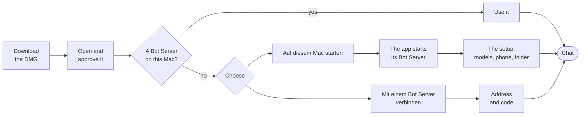

# The Mac app

A plan, written 2026-11-22, and what was built of it in `apps/mac` (milestones 1 to 5). Where
the build went another way than the plan, this text says so and why. What is not built yet is in
[Not built yet](#not-built-yet).

Today a Bot Server comes to a Mac through a terminal: `npx wizards bot install` (engenty
wizards' launcher) or by hand ([install.md](install.md)). The Mac app is the way without one:
download, open, and either start a Bot Server on this Mac or connect to one that runs elsewhere,
such as a hosted home at `<name>.wizards.bot` ([hosted.md](hosted.md)). You don't need Node.js,
a terminal or developer tools.

The flow follows Nod's desktop app (n8n-io/nod, read at `940c88a`): download the installer, open
and approve it, then "Get started" or "Connect to a server". What Nod does behind those buttons
is heavier than what we need: Nod runs its server in Electron and a Linux VM (Lima, Apple's
Virtualization framework) with PostgreSQL and Docker inside, downloaded as a runtime pack of
about 1.8 GB. A home is one Node process with SQLite files. Our "prepare the computer" is
seconds, not a VM.

## First launch



### Open and approve

1. The person drags the app from the DMG into Applications and opens it. The app is notarized,
   so macOS asks once whether to open an app from the internet: "Öffnen".
2. Opened from anywhere but Applications (the DMG, Downloads), macOS runs it from a random
   read-only path (App Translocation). A login item registered from there breaks on the next
   start. The app offers to move itself to Applications before anything else.

### Auf diesem Mac starten

1. **The app starts its Bot Server.** The app carries its own Node and the home (see
   [What the app carries](#what-the-app-carries)). It registers the home as a LaunchAgent of the
   person with `SMAppService.agent(plistName:)`: the plist lies in the app bundle
   (`Contents/Library/LaunchAgents/bot.wizards.home.plist`) and names the app's own program
   with `BundleProgram` and the argument `--home`, so the agent always runs the Node and the home
   of the app that is installed. Built that way because a plist in a bundle is fixed: it cannot
   name the bundle's place on the disk for `cli.ts`, nor `~` for the log. The program finds both
   next to itself (`HomeLauncher.swift`), sends what the home prints to
   `~/.engenty/wizards-bot/logs/home.log`, and becomes Node with `execv`, so launchd keeps the
   home itself. Data stays in `~/.engenty/wizards-bot`, port 4747, as with every other install.
   Earlier Bot Servers kept it in `~/.wizards-bot`; the home moves it over on its first start
   (docs/install.md). Later all of it moves to `~/.wizards/`, with the move of the domain.
2. **macOS approves it.** On registering, macOS shows "Background item added". If the person
   turned background items off for us before, `SMAppService.status` is `.requiresApproval`; the
   app says so in one sentence and opens System Settings → General → Login Items
   (`SMAppService.openSystemSettingsLoginItems()`). This is our "approve it" step.
3. **The app waits for `GET /health`** (it answers once the home runs, usually in a second or
   two) and pairs itself (see [Pairing the app](#pairing-the-app)).
4. **The setup** opens in the app's window: the home's own setup (`apps/home/src/setup`), the
   same one the browser shows, with the checks of
   [Prepare the computer](#prepare-the-computer). It ends with the QR for the phone.

The home keeps running when the window closes and when the app quits: it is a LaunchAgent, not
a child of the app. That is unlike Nod, whose tasks run only while its window is open. A home's
tasks, channels and phone need it to run. The menu bar item shows whether it runs, opens the
window, shows the QR for a phone, and has "Bot Server anhalten" and "Bot Server starten". Stopping
is `SMAppService.unregister()`: with `KeepAlive` launchd would start a home it was only told to
stop, so a stopped Bot Server is one macOS forgets until it is started again.

### Mit einem Bot Server verbinden

1. The person types the address (`ada.wizards.bot`, `macmini.local:4747`, an `https://…`) and
   the code the Bot Server shows (`K7QM-2RXD`), or pastes a pairing link
   (`wizardsbot://pair?home=…&code=…`, the link the QR holds; the app registers the
   `wizardsbot:` scheme on the Mac too).
2. The app adds `https://` where no scheme is given, and `:4747` for a `.local` name without a
   port. It asks `GET <address>/health` first, with a 10 second limit. What goes wrong is said
   plainly and in one sentence each: no such address, no answer, a certificate that is not
   valid, an address that answers but is not a Bot Server, a code that was used or ran out.
3. On success the window shows the Bot Server's web app, paired. No home starts on this Mac.

A Mac that connects to a hosted home can still offer its own models to it: the hosted home has
the gateway only, and this Mac may have Ollama or a signed-in subscription. The same window
offers one more line, "Die Modelle dieses Macs anbieten". On a yes the app registers its agent
with `wizards-bot link <address> <code>` instead of `start` (a linked computer, as `wizards bot
setup --link` does today). It is the same LaunchAgent, with another argument. Not built yet: the
plist's arguments are fixed, so the launcher has to read the mode from the data folder first.

### A Bot Server is already on this Mac

`wizards bot install` puts the home in `~/.engenty/wizards/bot/<version>` with its own
LaunchAgent `com.engenty.wizards.bot` (`~/Library/LaunchAgents/com.engenty.wizards.bot.plist`)
and `~/.engenty/wizards/bot/bot.json`. A home started by hand in a terminal has neither. Both use
the data folder (`~/.engenty/wizards-bot`, or `~/.wizards-bot` of an earlier one) and port 4747.

Before the first screen, the app looks:

| What it finds                                               | What it does                                                                                                                                                                                                                                                                                                                                                                                 |
| ----------------------------------------------------------- | -------------------------------------------------------------------------------------------------------------------------------------------------------------------------------------------------------------------------------------------------------------------------------------------------------------------------------------------------------------------------------------------- |
| A Bot Server answers on `127.0.0.1:4747`                    | "Auf diesem Mac läuft schon ein Bot Server." "Verwenden" pairs with it and opens the chat. It starts no home of its own. The code comes from that home's own command (`~/.engenty/wizards/bin/wizards-bot pair`), never from the app's: the app's home may be newer and would change the data under the running one. Without that command the connect form opens with the address filled in. |
| `com.engenty.wizards.bot` is installed, but nothing answers | The same sentence, with "Starten" (`launchctl kickstart gui/<uid>/com.engenty.wizards.bot`).                                                                                                                                                                                                                                                                                                 |
| Only a data folder with data, no home, no LaunchAgent       | "Auf diesem Mac starten" uses that data: the agents, the conversations and the paired phones are all there.                                                                                                                                                                                                                                                                                  |
| Something else answers on 4747                              | The app says the port is taken and by which program (`lsof -iTCP:4747 -sTCP:LISTEN`), and starts nothing.                                                                                                                                                                                                                                                                                    |

There is never a second home on 4747 and never a second home on the same data folder: one data
folder has one home key and one `home.db`.

A home of `wizards bot install` keeps running as it is; its updates stay with `wizards bot
update`. The app offers, in its settings and never on its own, "Den Bot Server mit der App
aktualisieren". On a yes:

1. It stops `com.engenty.wizards.bot` (`launchctl bootout`) and sets its plist aside as
   `com.engenty.wizards.bot.plist.off`, so the person can go back; `wizards bot uninstall`
   deletes it.
2. It registers its own agent on the same data folder.
3. It refuses when its home is older than the one that last wrote the data (see
   [What the home needs](#what-the-home-needs)): a newer `wizards bot install` stays.

The other direction is in the `wizards` command (engenty wizards' repo): `wizards bot install`
asks `launchctl print gui/<uid>/bot.wizards.home` and, when the app's agent is there, says
"The wizards.bot app runs your Bot Server; it updates it" and installs nothing.

### Pairing the app

The app is a device of the home, like the browser and the phone.

- **This Mac's home.** The app runs `node <bundle>/bot/apps/home/src/cli.ts pair --json` with
  the bundled Node: it opens the same data folder and makes a pairing code that works once, for
  10 minutes, as `wizards-bot pair` does today. Nobody types a code.
- **Another home.** The code the person typed.
- In both cases the app pairs itself: `POST /v1/pair` with the code, named after the Mac
  (`Host.current().localizedName`), as a `browser`. A code that is used or ran out is said on the
  connect form. The token goes to the web app once, where it keeps its own (`wizards.token` in
  the web view's storage for that address), and the window loads the address. The plan had the
  web app pair itself from `<address>/#code=<code>`; built that way, the page loaded twice when
  the window appeared, the second load found the code used, and the person saw "Dieser Code gilt
  nicht mehr" without knowing why. Moving the token to the Keychain through the bridge is
  possible later; a browser on the same Mac keeps it no safer today.

## Where the chat comes from

| Way                                              | What it costs                                                                                                                                                                                                                                                                                                                                                                           | What we get                                                                                                                                                                 |
| ------------------------------------------------ | --------------------------------------------------------------------------------------------------------------------------------------------------------------------------------------------------------------------------------------------------------------------------------------------------------------------------------------------------------------------------------------- | --------------------------------------------------------------------------------------------------------------------------------------------------------------------------- |
| The iPad app as "Designed for iPad"              | Nothing to build, but it is useless for this plan: Apple silicon only, the Mac App Store only, the iOS sandbox. It cannot carry Node, start a home or register a LaunchAgent.                                                                                                                                                                                                           | A device for a home elsewhere, nothing more                                                                                                                                 |
| The iPad app through Mac Catalyst                | No setup screens (the setup is in the web app; `apps/ios` has none), no block editor for documents (`apps/web/src/blocks`). Six files import UIKit (`UIApplication`, `UIDevice`, the drawer); VisionKit's document scanner, `MFMessageComposeViewController` and WatchConnectivity have no Mac counterpart. The menu bar item and `SMAppService` need an AppKit bundle beside Catalyst. | Native controls, the phone's on-device model (FoundationModels) and EventKit on the Mac later                                                                               |
| A native macOS target sharing the SwiftUI views  | The same missing setup and editor as Catalyst, and every UIKit use rewritten for AppKit. Two Swift UIs to keep equal to the web app.                                                                                                                                                                                                                                                    | The most Mac-like app                                                                                                                                                       |
| A native shell with the web app in a `WKWebView` | A Swift shell of a few files: the first screen, the agent, the menu bar item, the updater. A small bridge for notifications and the folder dialog. Looks like a web page in places: text selection, context menus and keyboard focus need care.                                                                                                                                         | The setup with its live checks, documents, artifacts and the three columns of `lib/layout.ts`, today and with every release. The same app the browser and hosted homes show |

**Recommendation: the native shell with the web app in a `WKWebView`.** The chat on a computer
is the web app already: it has the setup, the folder dialog of the Mac, the block editor and the
artifacts, and the home serves it at every address. The iPad app is a device with a phone's
strengths (the on-device model, the phone's calendar and contacts, the camera, the watch), and
none of them is what the Mac app is for. Catalyst would bring a second chat to keep equal to
the web app and still lack the setup.

The shell's parts:

- **Window.** One `WKWebView` per window, on the paired address. Links to other addresses open
  in the person's browser. A `wizardsbot://pair` link opens the connect screen.
- **Bridge** (`WKScriptMessageHandler`, behind a small `window.wizardsMac` the web app checks
  for):
  - Notifications: the web app's `lib/notify.ts` decides what is worth telling; on the Mac it
    hands the notice to the shell, which posts it with `UNUserNotificationCenter` and opens the
    card when it is clicked. `WKWebView` has no `Notification` of its own.
  - The folder dialog: `NSOpenPanel` in the app's window instead of the home's `osascript`
    (`apps/home/src/folders/folders.ts`), when the home runs on this Mac.
  - The badge on the Dock icon: the number of what needs you.
- **Menu bar item.** Whether the Bot Server runs, "Öffnen", "Telefon verbinden" (the QR),
  "Bot Server anhalten".
- **Native screens**, few and small: the first screen with the two paths, the connect form,
  what is found on the Mac, the approval of the background item, and an error when the home does
  not start (with its log). Everything else is the web app.

The shell lives in `apps/mac`: Swift and SwiftUI, an Xcode project of its own, bundle
`bot.wizards.mac`, team 7X9X3MSWJA. It shares nothing with `apps/ios` but the pairing link's
format.

## What the app carries

```text
wizards.app/Contents/
  MacOS/wizards                         the shell
  Library/LaunchAgents/bot.wizards.home.plist
  Resources/node/bin/node               Node, official build, re-signed by us
  Resources/bot/                        the release tarball, installed
    apps/home/src/cli.ts                ...
    apps/web/dist/
    packages/
    node_modules/                       npm install --omit=dev, for this architecture
  Frameworks/Sparkle.framework
```

- **Node.** The official `node-v24.x-darwin-arm64.tar.xz` from nodejs.org, checked against its
  `SHASUMS256.txt`, at the version CI tests with (Node ≥ 24.11, `engines`). Only `bin/node` goes
  in, not npm. 119 MB on disk (measured: v24.14.0, arm64), about 25 MB compressed.
- **The home.** `wizards-bot-<version>.tgz` of the same release ([install.md](install.md)),
  unpacked, `npm install --omit=dev` with `--cpu=arm64 --os=darwin` so libSQL's native module
  is the Mac's (`@libsql/darwin-arm64`, 7.5 MB). 365 MB on disk (measured on the install of
  0.1.1), 41 MB compressed with xz. Of that, `@mastra` is 166 MB. `pnpm pack:mac` prunes
  source maps, type files, Markdown and the tests of packages (177 MB) and leaves 188 MB. Not
  `examples`: three.js keeps the addons there that artifacts import (`three/addons/…`). Then it
  starts the pruned home from the signed bundle once.
- **Native modules.** `@libsql/darwin-*/index.node`, and `fsevents.node` where a dependency
  pulls it in. Each is signed with our certificate in the build; none is loaded from outside the
  bundle.
- **The home writes nothing into the bundle.** A write would break its signature. The launcher
  starts the home in the data folder and without `NODE_COMPILE_CACHE` or `NODE_OPTIONS`; every
  path the home writes to is under its data folder. `pnpm pack:mac` starts the home from the
  signed bundle and checks the signature after.
- **Size.** Measured on 0.1.1 with Node 24.22.3: the app is 312 MB installed (the home 188 MB,
  Node 116 MB, Sparkle 3 MB), the DMG 63 MB (LZMA, `ULMO`; LZFSE made 163 MB). Nod's DMG is
  smaller, its runtime pack much larger.

### Architectures

Apple silicon (arm64) first. An Intel build is the same script with `x64`: Node's x64 build and
`@libsql/darwin-x64`. Two DMGs, one per architecture, as Nod does, rather than a universal app:
a universal one carries Node and libSQL twice (about 120 MB more on disk) for every person. A
Mac with Intel rarely runs a useful Ollama model; it still runs subscriptions and gateways.

### Updates

The home is inside the app, so the app and its home have one version and update together:

- **Sparkle 2** checks `https://github.com/engenty/wizards-bot/releases/latest/download/appcast.xml`
  when the app starts and every six hours. The appcast is an asset of each release, signed with
  our EdDSA key; Sparkle checks that key and the Developer ID of the new app, and refuses a lower
  version.
- It shows "Update bereit" and installs on "Neu starten" or when the app quits. After the new
  bundle is in place, the app restarts its agent (`launchctl kickstart -k
  gui/<uid>/bot.wizards.home`). A running turn stops; a run that waits for a card resumes after
  the start, as after any start of the home.
- The home's own data changes run when it starts, as today.
- Sparkle is the one dependency of `apps/mac` that is not Apple's. An updater of our own
  (download, `SecStaticCodeCheckValidity` against our team, replace a running app in
  Applications, relaunch) is the part Sparkle has solved for years; we would get its edge cases
  wrong first.

### Uninstall

- "Von diesem Mac entfernen…" in the app's settings: it stops the home, removes the agent
  (`SMAppService.unregister()`), and asks about the data: "Entfernen, Daten behalten" or
  "Entfernen, Daten in den Papierkorb". The data goes to the Trash, not away, so the person can
  still take it back. An export before it (`wizards-bot export`) is not offered in the app yet:
  it asks for a passphrase in a terminal. Then the app can go to the Trash.
- An app dragged to the Trash without that: the agent cannot start without its bundle. Whether
  macOS also takes it off the login items by itself is checked in the second milestone; if not,
  the download page says to use the menu first.
- Uninstalling never touches a home of `wizards bot install`.

## Distribution

### Signing and notarization

- **Developer ID Application**, team 7X9X3MSWJA, with the hardened runtime and a secure
  timestamp, on every Mach-O in the bundle, inside out: each `.node`, `node`, Sparkle's helpers,
  the shell. Then `notarytool submit --wait` on the app, `stapler staple`, the DMG made with
  `hdiutil`, signed, notarized and stapled too.
- **Entitlements of `node`:** `com.apple.security.cs.allow-jit` and
  `com.apple.security.cs.allow-unsigned-executable-memory` (V8 compiles code at run time).
  Node's own build carries more (`disable-library-validation`, `allow-dyld-environment-variables`,
  `get-task-allow`); we drop them: every native module is signed by our team, so library
  validation can stay on, and `get-task-allow` is refused by notarization.
- **Entitlements of the shell:** `com.apple.security.device.camera` and
  `com.apple.security.device.audio-input`, no App Sandbox. The plan said none; under the hardened
  runtime the web view's camera (the composer's picture) and microphone (talking) need them.
- **What the home runs.** `claude` and `codex` are the person's own programs, found on their
  `PATH` and started with `spawn`; a hardened runtime does not limit the programs it starts,
  they run with their own signatures. Ollama is an HTTP call to `127.0.0.1:11434`; outside the
  sandbox a call needs no entitlement. The home listens on `0.0.0.0:4747` so the phone reaches
  it; with the macOS firewall on, macOS asks once whether `node` may accept connections, which
  the setup's "address" check names.
- **Who macOS names.** A LaunchAgent of `SMAppService` belongs to the app: questions of macOS for
  the home (a connected folder in Documents or iCloud Drive, the local network) name "wizards".
  For a home of `wizards bot install` they name "node" today. Checked in the second milestone.

### The release

`release.yml` gets a job on a macOS runner for every tag `v*`, after the tarball:

1. Take the tarball of this release and Node of the pinned version; install, prune, start the
   home once from the bundle (`/health`), stop it.
2. Build the shell with `xcodebuild archive`, put the parts in, sign, notarize, staple.
3. Make `wizards-bot-mac-arm64.dmg` (a name without the version, so
   `releases/latest/download/…` always gives the newest), notarize, staple.
4. Make the Sparkle archive and `appcast.xml`, signed with `sign_update`.
5. Attach the DMG, the archive and the appcast to the release.

Secrets of the repository: the Developer ID certificate (`.p12` and its password), an App Store
Connect API key for `notarytool`, Sparkle's EdDSA private key. `pnpm release` and
`pnpm release:tag` stay as they are.

### The download page

`https://wizards.bot/mac`, beside `wizards.bot/start`: what the app does in three sentences,
"Für Mac laden" (Apple silicon, macOS 14 or newer), the two paths, a link to "Lieber im
Terminal" (`npx wizards bot install`), and how to remove it. The button points at
`github.com/engenty/wizards-bot/releases/latest/download/wizards-bot-mac-arm64.dmg`.
`wizards.bot/start` (a hosted home) mentions the app as a way to use the hosted home on a Mac.

### Not in the Mac App Store

- An app in the Mac App Store must be sandboxed (guideline 2.4.5(i)). Sandboxed, the home's
  data would be in the app's container, not `~/.engenty/wizards-bot`; it could not start the person's
  `claude` and `codex` with their sign-ins in `~/.claude` and `~/.codex`; every connected folder
  would need the person to pick it in a dialog first.
- The home updates its own code with the app outside the store, and agents write and run
  artifacts; guideline 2.5.2 asks that an app not download or run code that changes it.
- The person gets the app from the download page and updates through Sparkle. The iPhone and
  iPad app stays in the App Store as it is.

## Prepare the computer

For Nod this is a VM, a database and containers. For us it is the home's start and the setup
the home already has. The app adds what only an app on the Mac can do.

| Setup check (`apps/home/src/setup`)        | On the Mac app                                                                                                                                                                                                                                                                                                                                                                                                                                                        |
| ------------------------------------------ | --------------------------------------------------------------------------------------------------------------------------------------------------------------------------------------------------------------------------------------------------------------------------------------------------------------------------------------------------------------------------------------------------------------------------------------------------------------------- |
| `model` Claude Code, Codex (`probeClient`) | Found on the person's `PATH` (`installed()` runs `which`) and tested with a short call. The agent's `PATH` is the problem: a plist in a bundle cannot name the person's own. The app reads it once from the login shell (`$SHELL -lic 'echo $PATH'`) and hands it to the home.                                                                                                                                                                                        |
| `model` Ollama (`probeOllama`)             | Running, a model with tools, and the model fits: up to 55 % of the Mac's memory (`MEMORY_SHARE`). Not running: "Ollama öffnen" when it is installed, the link to ollama.com when not. We never bundle Ollama.                                                                                                                                                                                                                                                         |
| Pull a model (new)                         | When Ollama runs without a model that fits, or only with models without tools, the setup offers one by memory, with its size, and pulls it on a click through Ollama's `POST /api/pull`, with its progress in the setup (`POST /v1/setup/pull`, docs/protocol.md): the largest of `qwen3:14b`, `8b`, `4b` and `1.7b` that fits 55 % of the memory, so `qwen3:8b` from 16 GB and `qwen3:14b` from 17 GB. The names live in the home (`SUGGESTED`, `models/ollama.ts`). |
| `model` gateway, wizards account           | As today. A hosted home's gateway is not on this path.                                                                                                                                                                                                                                                                                                                                                                                                                |
| `address`                                  | `http://<name>.local:4747` for the phone at home; the firewall question when it is on.                                                                                                                                                                                                                                                                                                                                                                                |
| `data`                                     | `~/.engenty/wizards-bot`, never a temporary folder (the check exists).                                                                                                                                                                                                                                                                                                                                                                                                |
| `folders`                                  | The folder dialog through the bridge; macOS asks for Documents, Desktop or iCloud Drive in the app's name.                                                                                                                                                                                                                                                                                                                                                            |
| `push`                                     | As today: the phone is told by the home only with an Apple key (`wizards-bot push`).                                                                                                                                                                                                                                                                                                                                                                                  |
| `capability`                               | As today.                                                                                                                                                                                                                                                                                                                                                                                                                                                             |

A check's `command` (`ollama serve`, `claude`, `codex login`) is a line for a terminal. In the
app it stays shown as it is, with "Terminal öffnen" beside it; a check where the app can do it
itself (open Ollama, pull a model) gets a button instead.

Everything is still set up in the setup and in the conversation ("Everything is set up by
conversation", AGENTS.md); the app adds no settings page of its own beyond the background item,
updates and removing the Bot Server.

## What the home needs

Small changes in `apps/home`, each useful without the app too:

1. `GET /health` says what it is: `{ "ok": true, "version": "0.2.0", "home": true }`, so the app
   can tell a Bot Server from something else on 4747. It still needs no sign-in.
2. `wizards-bot pair --json`: the address and the code as JSON, without the QR.
3. The version that last wrote the data folder, kept in it. An older home refuses to start on
   it and says which version is needed.
4. `PATH` for subscriptions: the folders of `WIZARDS_BOT_PATH` and of the file `path` in the
   data folder, in front of the process's own. The app writes the file from the login shell
   (`$SHELL -l -i -c`) before it starts its Bot Server and at every start of the app, and starts
   the Bot Server anew when it changed.
5. The setup's model pull: a model offered by memory, pulled on a yes, its progress as setup
   events.
6. `NODE_COMPILE_CACHE` and every other write inside the data folder (or `TMPDIR`), never next
   to the code.

And in engenty wizards: `wizards bot install`, `update` and `status` know the app's agent
`bot.wizards.home` (above), and `docs/hosted.md`'s Contract gets a point 10, the Mac app.

## Milestones

| #   | What                                                                                                                                                                                                                                                                                                | Size                                   |
| --- | --------------------------------------------------------------------------------------------------------------------------------------------------------------------------------------------------------------------------------------------------------------------------------------------------- | -------------------------------------- |
| 1   | **Connect.** `apps/mac`: the first screen, "Mit einem Bot Server verbinden", the web view, the notification bridge, the menu bar item. A development build that pairs with a hosted home or the home of this repo.                                                                                  | M, about a week                        |
| 2   | **Start on this Mac.** Node and the home in the bundle (a script `pnpm pack:mac`), the agent with `SMAppService`, the approval, what is already on the Mac, pairing without a code, the home's changes 1 to 4 and 6. Measure size and memory; check what macOS names and what happens in the Trash. | L, about two weeks                     |
| 3   | **Prepare the computer.** `PATH` from the login shell, the setup in the app with buttons for what the app can do, the model pull (home change 5), the folder dialog through the bridge.                                                                                                             | M, about a week                        |
| 4   | **Ship.** Signing inside out, notarization, the DMG, the job in `release.yml`, the secrets, `wizards.bot/mac`. The first public DMG.                                                                                                                                                                | M, about a week                        |
| 5   | **Update and remove.** Sparkle and the appcast, the agent's restart after an update, the take-over of a `wizards bot install` home, removing the Bot Server, the `wizards` command's side.                                                                                                          | M, about a week                        |
| 6   | Later: an Intel DMG when someone asks; the Mac as a device with resources of its own (its calendar, reminders, contacts with EventKit, the on-device model), as the phone does.                                                                                                                     | S for Intel, L for the Mac as a device |

1 to 5 are about six weeks for one person. 1 ships nothing alone; 4 is the first thing people
download.

Built on 2026-11-22, all five in a first version: `apps/mac`, `pnpm pack:mac`, the home's changes
1 to 6, the model pull in the setup, the job `mac` in `release.yml` and Sparkle. What was checked
on a Mac (macOS 27.2, Apple silicon, Xcode 27.2):

- `pnpm pack:mac --dmg`: the bundle signed with an Apple Development certificate, the home
  started from it answered `/health`, the signature held after, the DMG verified.
- The app's first screen found the Bot Server of `wizards bot install` on 4747 and offered it,
  and offered no start beside it.
- "Mit einem Bot Server verbinden" with a home of this repository on another port: a wrong code
  said so on the form; the right one paired the Mac under its name and opened the setup in the
  window; after a restart the app opened the chat without a code.
- The Swift tests (addresses, pairing links, `/health`, versions, `pair` output, the login
  shell's `PATH`, pairing) and the home's tests for 1 to 5.

The LaunchAgent, checked the same day with the Bot Server of `wizards bot install` stopped
(`launchctl bootout`) and its data backed up:

- The take-over in the settings set that LaunchAgent's plist aside (`.plist.off`), registered
  `bot.wizards.home` with `SMAppService` and the Bot Server answered on 4747 within seconds, on
  the same data. macOS asked nothing: the item was "enabled, allowed" in its background items,
  under `bot.wizards.mac`. launchd's process is the bundled Node itself (the launcher's
  `execv`), its log in `~/.wizards-bot/logs/home.log` (the data folder then).
- The app wrote the login shell's `PATH` into the data folder's `path`, and the Bot Server found
  Claude Code with it (`claude:default`), which a LaunchAgent's own `PATH` does not reach.
- The app paired itself with the code of its own `pair --json` and showed the person's chat.
- The app quit: the Bot Server kept answering. The app started with an older version noted: it
  started the Bot Server anew (`kickstart -k`, a new process).
- "Entfernen, Daten behalten": launchd no longer knows `bot.wizards.home`, port 4747 is free,
  the data stayed, the `path` file went; macOS keeps the background item as "disabled".
- Afterwards the data from before and the plist of `wizards bot install` went back, and that
  Bot Server ran as before.

Not checked yet: the approval when the person turned background items off
(`.requiresApproval`), an update through Sparkle, notarization, what macOS names in its
questions about folders, and an app dragged to the Trash with its Bot Server registered. They
need the Developer ID secrets, a published update, or a person at the Mac to answer macOS.

## Not built yet

- The Mac's models for a hosted home ("Die Modelle dieses Macs anbieten", a linked computer).
- An export before removing the Bot Server; the app moves the data to the Trash instead.
- The `wizards` command's side (engenty wizards' repository): `wizards bot install`, `update` and
  `status` do not know the app's LaunchAgent `bot.wizards.home` yet, and its `bot.json` still
  names `~/.wizards-bot` as `"data"` (docs/hosted.md, Contract 9).
- The page `wizards.bot/mac`.
- The secrets of the job `mac` (it says which), and the Sparkle key pair: without
  `SPARKLE_PUBLIC_KEY` the app does not look for updates.
- An Intel DMG, and the Mac as a device with resources of its own.

## Risks

| Risk                                                                                                         | What we do                                                                                                                           |
| ------------------------------------------------------------------------------------------------------------ | ------------------------------------------------------------------------------------------------------------------------------------ |
| The bundle is large (312 MB installed, a 63 MB DMG), mostly `@mastra`                                        | Prune in the build and measure each release; `pnpm pack:mac` prints both sizes                                                       |
| The agent's `PATH` misses `claude` or `codex` (nvm, Homebrew, `~/.local/bin`)                                | Read it from the login shell; the subscription check says which path it looked in                                                    |
| The home writes into the bundle and breaks its signature                                                     | Writes go to the data folder; `pnpm pack:mac` starts the home from the bundle and checks the signature after                         |
| An update replaces the bundle under the running home                                                         | Restart the agent after Sparkle; a waiting card resumes after the start                                                              |
| A Mac laptop sleeps, and tasks wait for it                                                                   | Said on the download page and in the setup; a hosted home with this Mac as a linked computer is the way for tasks that must run      |
| macOS asks about the local network or a folder and names the wrong program, or asks again after every update | Checked in milestone 2 on a clean Mac; the agent's designated requirement stays the same across updates (same team, same identifier) |
| Two homes on one data folder (the app's and a `wizards bot install`)                                         | The app never starts one when another answers or is installed; the take-over removes the other first                                 |
| Notarization fails on something deep in `node_modules` (a prebuilt binary we do not know of)                 | The build lists every Mach-O and signs each; an unknown one fails the build, not notarization                                        |

## Decisions

Taken as recommended on 2026-11-22, when the build started.

| #   | Question                                     | Decision                                                                                                                                |
| --- | -------------------------------------------- | --------------------------------------------------------------------------------------------------------------------------------------- |
| 1   | Where the chat comes from                    | A native shell with the web app in a `WKWebView`                                                                                        |
| 2   | The updater                                  | Sparkle 2, the one non-Apple dependency of `apps/mac`                                                                                   |
| 3   | Architectures                                | Apple silicon only at first; an Intel DMG when someone asks                                                                             |
| 4   | The oldest macOS                             | macOS 14 (`SMAppService` needs 13; the web view needs nothing newer). The Mac as a device with the on-device model would need 26, later |
| 5   | One version for the app and the home         | Yes: the app is built in every release, its home is that release's tarball                                                              |
| 6   | Does the home stop when the app quits        | No. It is a LaunchAgent; the menu stops it                                                                                              |
| 7   | A home of `wizards bot install` already runs | Use it as it is; take it over only when the person says so in the settings, on the same data                                            |
| 8   | The Mac App Store                            | No (sandbox, the person's subscriptions, updates of the home)                                                                           |
| 9   | Ollama in the app                            | No: open it or link to ollama.com, and pull a model on a yes                                                                            |
| 10  | The device token of the app                  | In the web view's storage, as a browser keeps it; the Keychain through the bridge later if a reason comes up                            |
